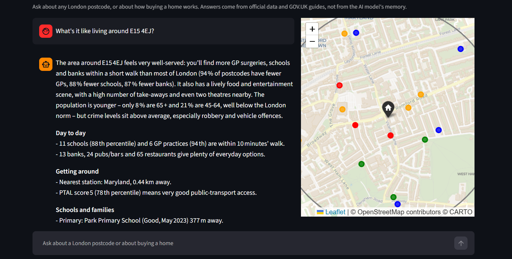
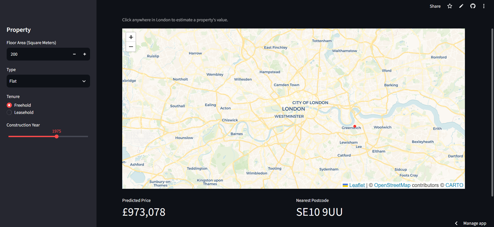

# London Property Intelligence Platform


Two tools for people buying a home in London, behind one API and one app:

- **An Area Chatbot** that tells you what living at a specific postcode is actually like: what is
  within a 10-minute walk, the nearest schools and their latest Office for Standards in Education (Ofsted results),
  transport, air quality, crime, prices, rents and council tax, every figure compared with the rest of London. It
  also answers how-to questions (leasehold, stamp duty, conveyancing, shared ownership) from the
  official guides. Every fact comes from public data and the language model only
  writes the sentences. Its answers are evaluated with code checks and an LLM judge, and its data
  refreshes itself every month.
- **A house price model** trained on 1.4 million EPC-linked Land Registry sales, scoring R² 0.89 with
  a £47k median error on 2024 sales held out of training entirely.

---

## Live demo

| | |
|---|---|
| App (area chat, price map, price estimate) | [london-property-intelligence.streamlit.app](https://london-property-intelligence.streamlit.app/) |
| API documentation | [london-property-api.onrender.com/docs](https://london-property-api.onrender.com/docs) |

The API runs on Render's free tier, which shuts the service down after 15 minutes of inactivity,
so the first request can take 30 to 60 seconds while the container starts. The chatbot runs on
Groq's free tier, which allows roughly one detailed answer per minute.



---

## The area chatbot

### What it does

Ask "What's it like living around a certain Postcode?" and the answer opens with the character of that exact
location, built from whatever is furthest from typical for London. It then covers day-to-day life, getting around, 
schools, green space, safety, environment and costs, tailored to the buyer (families, commuters, first-time buyers), 
and ends with a short list of things the data cannot tell you, such as noise or the street at night. Every answer names its sources
and periods.

### How it works

The model never states facts about a place from memory. It is given a menu of tools, decides which
to call, my code runs them against the processed data, and the model writes the answer from the
results. This is tool calling with a short hand-written agent loop (capped at 5 rounds), not a
framework such as LangChain. The loop is about 20 lines and testable.

| Tool | What it returns |
|---|---|
| `get_neighbourhood` | One-call overview of a postcode: location facts, ward crime, ages and tenure, borough prices, rents and council tax, counts of 17 kinds of places within a 10-minute walk, the nearest essentials, and what is unusually high or low compared with London |
| `find_nearby` | Places of one type near a postcode (a chain, a cuisine, a school phase), nearest first |
| `council_tax` | The 2026-27 bill for any band in the postcode's borough |
| `stamp_duty` | Stamp Duty Land Tax band by band, with first-time buyer relief and surcharges |
| `get_guide` | The best-matching sections of 12 GOV.UK buyer guides, with links |

The code does the comparing and the model does the meaning. Language models can be unreliable 
so every comparison is computed before the model sees it: each ward measure comes with
its percentile among London's 704 wards, each walk count with its percentile among a benchmark of
5,000 random London postcodes, and borough prices and rents with their percentage difference from
London. The overview also lists, by direction, the measures that are higher or lower than most of
London, because an early version that mixed them in one list was read the wrong way round.

Retrieval was measured, not assumed. For the GOV.UK guides I labelled 19 realistic buyer
questions with the section that actually answers them. Searching all 76 sections with TF-IDF put the
right one in the top two for 16 of 19, and could not tell off-topic questions from real ones.
Letting the model pick the guide first (12 clear choices) and TF-IDF rank the sections within it
scored 19 of 19. With 76 short passages a vector database would add memory and cost for no measured
gain, so there isn't one.

The system prompt explains every field the tools return, bans the
kinds of detail the model tended to invent in testing (train lines, journey times, school
reputations, policing), describes places rather than people, never labels an area safe or
dangerous, and adds the caveats that matter: per-resident crime rates are inflated where visitors
outnumber residents, flood zones ignore defences, prices are borough-wide. Tool errors
go back to the model as text so it can correct itself or explain.

### Evaluation

Spot checks don't show how often a chatbot gets things wrong, so I wrote 40 new questions on
postcodes never used while writing the prompt: area overviews, buyer types (families, commuters,
first-time buyers, retirees), nearby searches, council tax and stamp duty, GOV.UK guide questions,
trap questions (no postcode, a postcode outside London, "is it safe?", "will prices rise?") and
follow-ups. Each answer is checked two ways:

- **In code**, for free and the same every time: did it call the right tool for the right postcode,
  does it contain the expected figures and names (exact council tax and stamp duty amounts, the shop
  that was asked about), and can every number in it be traced to the data the tools returned?
- **By an LLM judge** for what code can't check: a model from a different family (Qwen 3.8 27B, so no
  model marks its own work) reads the question, the tool data and the answer, and lists unsupported
  claims, contradictions and guardrail breaches, plus helpfulness from 1 to 5. Its output is forced
  into a fixed JSON schema. Before trusting it I tested it on 10 errors I had found by hand in 20b's
  answers: it caught 8. It also flagged things the chatbot is allowed to do, so I gave it the same
  data definitions as the chatbot and a list of what not to report.

Groq's free tier allows 200,000 tokens per model per day and a question costs about 8,000, so the
runs resume where they stop. Both models answered the first 27 questions (area, buyer, nearby, tax
and one guide question); the traps, the remaining guide questions and the follow-ups have not been
run yet. Results on those 27:

| | gpt-oss-120b (live) | gpt-oss-20b |
|---|---|---|
| Right tool, right postcode | 27 / 27 | 25 / 27 |
| Expected figures and names present | 15 / 16 | 14 / 16 |
| Every number traceable to the data | 26 / 27 | 23 / 27 |
| Helpfulness (judge, 1 to 5) | 4.5 | not comparable* |
| Median response time | 3.4 s | 2.0 s |
| Tokens per question | about 8,100 | about 8,000 |

\* 20b was judged with an earlier version of the judge prompt.

The traceability row counts after checking every flag by hand: the scorer flagged 3 of 120b's answers,
and 2 were its own artefacts (a 5% rate written as "0.05", the "26" in "2025-26"). 20b's misses were
real: it invented stamp duty figures without calling the tool, put a shop 363 m away "within 300 m",
and asked a needless question instead of calculating non-resident stamp duty.

**What the checks found in the live model's answers.** I verified all 29 of the judge's flags against
the tool data: 19 were real and 10 were mistakes by the judge (it called the 16th percentile "not the
bottom sixth", for example), so its flags are reviewed rather than trusted. 13 of the 27 answers
contained at least one claim the data doesn't support, mostly small (some contained more than one):

| Pattern | Answers | Example |
|---|---|---|
| Transport links from general knowledge | 5 | "Northern Line and Overground" near Harrow (wrong), bus routes, "quick links to Kent" |
| An older Ofsted grade presented as the current one | 2 | "Good" for a school whose newest report card has no overall grade |
| Labels the rules forbid | 2 | "comparatively safe", "a little gritty" |
| A percentile read as a share | 1 | "only 3% under 15" where 3 is the percentile (the share is 11%) |
| A claim about residents the data doesn't hold | 1 | "dominated by young professionals" (the data has ages, not jobs) |
| Details not in the GOV.UK text | 1 | "First-tier Tribunal" where the guide says "a tribunal" |
| Ranking or rule from memory | 2 | "second-largest share in London", the old £425,000 first-time buyer threshold |
| Search not widened | 1 | "No Lidl" after a 1 km search; there is one about 1.5 km away |

The data side holds up: tools, figures and tax amounts were right in almost every answer. The main
remaining failure is the model filling gaps with general knowledge of London, and transport is the
biggest gap, because the data gives the nearest station but not the lines that serve it. The code
checks and the judge caught different errors (the code caught the Lidl and the £425,000 threshold,
the judge the transport claims and the misread percentile), so both are needed. On these results
gpt-oss-120b stays the live model: more accurate tool use and better-grounded numbers than 20b for
the same tokens, at about a second slower. Scores by category and the overall metrics are logged to
MLflow for each run.

### Data

| Topic | Source |
|---|---|
| Postcodes, wards, nearest station | ONS Postcode Directory (via Doogal), ONS ward boundaries (Dec 2024) |
| Crime | Metropolitan Police, last 12 months, per 1,000 residents (fraud excluded) |
| Population, ages, housing tenure | Census 2021, mid-2022 estimates |
| Deprivation | English Indices of Deprivation 2025 |
| Public transport access | TfL PTAL |
| Air quality | London Atmospheric Emissions Inventory 2022 |
| House prices, rents | UK House Price Index, ONS Price Index of Private Rents |
| Council tax | MHCLG Band D 2026-27 |
| Schools | DfE Get Information about Schools, Ofsted inspection outcomes |
| GP practices | NHS England |
| Supermarkets | Geolytix retail points |
| Parks | Ordnance Survey Open Greenspace (entrances) |
| Restaurants, cafés, gyms and other places | Overture Maps |
| Flood zones, conservation areas, Article 4, listed buildings | planning.data.gov.uk |
| Buying guidance | GOV.UK Content API (12 guides, 76 sections) |

A build script (`python -m london_property.area_data`) turns the raw files into five small tables
that the API loads at startup: 180,982 live London postcodes, a 704-ward profile with a London
average row, 94,236 places of 17 types, the 5,000-postcode walk benchmark and the guide sections.
All spatial work happens at build time in British National Grid metres, so the API needs no GIS
libraries and fits in Render's 512 MB (measured at 409 MB).

**Monthly refresh.** Crime, house prices and rents are published monthly, so a GitHub Action runs on
the 25th of each month. It downloads the newest release of each (finding the latest file on each
publisher's page, since the names change), recomputes only those columns with the same functions the
full build uses, re-downloads the GOV.UK guides, runs the test suite on the new data, and commits it
if anything changed, which redeploys the API. Each source is handled on its own: if one fails or has
nothing newer, its last good data stays and the run summary says why. Checked against the live
sources, the refresh reproduces the stored crime and rent figures exactly. House prices differ by up
to 2% for the same month, because Land Registry revises recent months as late sales are registered,
and the refresh takes the revised figures.

---

## The Price Model

### Results

| Metric | Value |
|---|---|
| R² (log price) | 0.88 |
| R² (raw £) | 0.89 |
| Median absolute error | £46,972 |
| Mean absolute error | £91,446 |

### Accuracy across the price range

| Price decile | Median price | Median error | Error % |
|---|---|---|---|
| 1 | £245000 | £29078 | 12% |
| 2 | £330000 | £28515 | 9% |
| 3 | £390000 | £29460 | 8% |
| 4 | £440000 | £30824 | 7% |
| 5 | £495000 | £38376 | 8% |
| 6 | £555000 | £45410 | 8% |
| 7 | £625250 | £54686 | 9% |
| 8 | £750000 | £72113 | 10% |
| 9 | £935000 | £101766 | 11% |
| 10 | £1575000 | £212895 | 14% |

Accuracy holds up well through the bulk of the market and falls off at the top end,
where price depends on things the data cannot see.



| Feature group | R² lost when removed |
|---|---|
| Location and area wealth | 0.22 |
| Year of sale | 0.19 |
| Size (floor area, rooms) | 0.11 |
| Property type and tenure | 0.02 |
| Construction age | 0.01 |
| Energy efficiency | 0.00 |

Location and size do the heavy lifting, which is what you would expect for London
housing. Energy efficiency contributes nothing to price in this data.

### How the pipeline works

**Cleaning.** 33 borough files hold 2.81 million transactions. After filtering that
comes down to 1,411,720 rows covering 2008 to 2024. Three filters do the work.
Anything before 2008 goes, because EPCs only became mandatory for property sales that
year and the linkage before then is unreliable. Prices outside £50k to £10M go, since
those are mostly transfers between family members or data errors rather than open
market sales. Floor areas outside 15 to 500 m² go for the same reason.

**Features.** Eighteen in total. Log floor area, number of rooms, construction year,
one-hot encoded property type and tenure, year and month of sale. Then everything
derived from the postcode: latitude, longitude, travel zone, deprivation index,
average income, distance to the nearest station. Finally, a smoothed target encoding
of the postcode district.

**Validation.** Split by time, not at random. London prices roughly doubled over the
period the data covers, so a random split would let the model see 2024 price levels
while training and then reward it for "predicting" them. That inflates the score and
tells you nothing about how the model would behave on genuinely new data. Training
runs on everything up to 2023 and the model is tested on 2024.

**Leakage control.** Target encoding uses the thing we are trying to predict, so it
has to be handled carefully. The district averages are computed on training rows
only, then applied to the test set as a lookup. They are also smoothed toward the
global mean, so a district with three sales does not get an extreme value the model
would overfit to. Imputation medians are computed the same way, on training data
only.

**Model.** XGBoost, depth 10, 1000 trees, learning rate 0.04. It was picked over
Ridge and Random Forest baselines using 2023 as a validation year, then refit on all
data through 2023 before the final test.

### Drift detection

New data does not stay like old data. Prices move, the mix of properties being sold
changes, and a model trained on last year's market slowly gets worse without ever
throwing an error. The drift workflow watches for this.

It runs whenever something is committed to `data/drift/`. For each feature it
computes a Population Stability Index against a reference sample of the training
distribution, then decides whether the change is big enough to justify retraining.

Run against 84,310 Greater London sales from 2025:

```
price          PSI = 0.262   DRIFTED
zone           PSI = 0.004   stable
imd_index      PSI = 0.003   stable
lat / lon      PSI = 0.002   stable
avg_income     PSI = 0.001   stable
propertytype   PSI = 0.001   stable
duration       PSI = 0.000   stable

Decision: RETRAIN, target (price) drifted, PSI 0.262
```

The geography is unchanged as London is still London, the same
postcodes with the same deprivation scores and the same stations. Prices are a
different story. The 2025 median sits well above what the model was trained on, and
that is exactly the situation where predictions start drifting low.

---

## Architecture

```
                    Streamlit app (one link, three pages)
          Area chat           Price map            Price estimate
              |                   |                       |
              +-------------------+-----------------------+
                                  |  HTTPS
                                  v
         +-------------------------------------------------------+
         |                 FastAPI on Render (Docker)            |
         |  POST /chat            agent loop -> Groq gpt-oss-120b |
         |  GET  /neighbourhood   /nearby  /guide                 |
         |  GET  /council-tax     /stamp-duty                     |
         |  POST /predict-price   GET /health                     |
         +---------------+---------------------------+-----------+
                         | loads at startup          |
           +-------------v-------------+  +----------v-----------+
           |  Area tables (Parquet)    |  |  Price model bundle  |
           |  postcodes, ward profile, |  |  XGBoost + target    |
           |  places + KD-tree, walk   |  |  encoding + medians  |
           |  benchmark, GOV.UK guides |  +----------------------+
           |  + TF-IDF index           |
           +---------------------------+

  GitHub Actions
    tests.yml     runs the test suite on every push
    drift.yml     runs on data commits: PSI check and retrain decision
    refresh.yml   monthly: new crime, prices, rents and guides, tested, committed, redeployed
```

### API

| Endpoint | Purpose |
|---|---|
| `POST /chat` | The chatbot. Send the conversation; get the answer and the tools it used. Stateless. |
| `GET /neighbourhood/{postcode}` | The overview the chatbot reads, compared with London |
| `GET /nearby/{postcode}?type=` | Places of one type nearby, with an optional subtype |
| `GET /guide/{guide}?question=` | Matching sections of a GOV.UK buyer guide |
| `GET /council-tax/{postcode}?band=` | Yearly council tax for a band |
| `GET /stamp-duty?price=` | Stamp Duty Land Tax with the band breakdown |
| `POST /predict-price` | The price model |

`/chat` validates its input (only user and assistant roles, so nobody can inject system
instructions; message length and count limits), sends only the last four messages to the model to
stay inside the free tier's token budget, and returns 429 when the model is rate limited and 503 when
it is unavailable, with the cause logged. Every chat writes one JSON line to the log (status, tools
called, tokens, response time) and never the user's text, since people type addresses into it.

---

## Tests

72 tests run on every push, with no API key or network needed: a fake language model stands in for
Groq in the agent, `/chat` and judge tests, and the refresh tests swap the downloads for small tables.

| File | Covers |
|---|---|
| `test_area_data.py` | The processed tables: London coverage, valid values, every postcode's ward has a profile, places inside London, unambiguous Ofsted dates, the guides, and a check that the GOV.UK stamp duty guide still matches the bands in the stamp duty tool |
| `test_tools.py` | Each tool, including hand-calculated stamp duty, the percentile maths, and 8 retrieval cases for the guides |
| `test_agent.py` | The agent loop: tool results reach the model, errors go back as text, the round cap, history trimming |
| `test_api_area.py`, `test_api_chat.py` | Status codes, validation, rate-limit and outage handling, and that chats are logged without their text |
| `test_evaluate.py`, `test_judge.py` | Number extraction (including the narrow no-break spaces gpt-oss writes in thousands), the scoring, and the judge's schema and input |
| `test_refresh.py` | The crime rates on a hand-checked table, newer data replacing older, and failed or older sources leaving the data unchanged |
| `test_model.py`, `test_api.py` | The price model and `/predict-price` |

---

## Tech stack

Python 3.11, pandas, scikit-learn, XGBoost and SHAP for the price model, with MLflow for experiment
tracking (the price model and the chatbot evaluations). GeoPandas and SciPy (KD-trees) for the area data build. Groq (gpt-oss-120b) with tool
calling for the chatbot, Qwen 3.8 27B on Groq as the evaluation judge, scikit-learn TF-IDF for guide retrieval and BeautifulSoup for cleaning the
GOV.UK pages. FastAPI, Pydantic v2 and Uvicorn for serving, packaged with Docker. Streamlit and
Folium for the app. GitHub Actions and pytest for CI. Hosted on Render (API) and Streamlit Community
Cloud (app).

---

## Running it locally

```bash
git clone https://github.com/samaddmirzaa/london-property-intelligence
cd london-property-intelligence

conda create -n lpi python=3.11
conda activate lpi
pip install -r requirements-dev.txt -r requirements-api.txt -r requirements.txt
pip install -e .
```

The chatbot needs a free Groq API key (console.groq.com) in a `GROQ_API_KEY` environment variable.
The map pages read a CARTO key from `.streamlit/secrets.toml` (`CARTO_KEY = "..."`).

```bash
uvicorn london_property.api:app --reload      # API at localhost:8000/docs
streamlit run streamlit/main.py               # the app (calls the live API)
python -m london_property.agent               # chat with the agent in the terminal
pytest tests/ -v                              # test suite
python -m london_property.drift               # drift check
python -m london_property.evaluate            # answer the evaluation questions (resumes if stopped)
python -m london_property.judge               # judge the saved answers
python -m london_property.refresh             # download this month's crime, prices, rents and guides
```

The processed tables the API needs are in the repository. The raw data is not, since it runs to
several hundred megabytes; every source above is public, `python -m london_property.area_data`
rebuilds the area tables from it and `python -m london_property.guide_data` re-downloads the guides.

---

## Limitations

- Groq's free tier allows about one detailed answer per minute,
  and the API sleeps when idle.
- The model can still add detail that isn't in the data, mostly transport links. The evaluation
  measures how often (above). The prompt bans the inventions seen in testing, but a prompt cannot rule
  them out completely.
- Prices and rents are borough averages, not street level, and crime rates per resident
  overstate the risk in central areas full of visitors. The answers say so.

---

## Repository layout

```
notebooks/              01-07 price model, 09-10 area data exploration
src/london_property/
    model.py            price model features and prediction
    api.py              FastAPI service
    agent.py            the chatbot: tool menu, system prompt, agent loop
    tools.py            the tools the chatbot calls
    area_data.py        builds the area tables from the raw data
    guide_data.py       downloads the GOV.UK guides
    refresh.py          monthly refresh of crime, prices, rents and guides
    evaluate.py         evaluation questions, code scoring, MLflow logging
    judge.py            the LLM judge
    drift.py            PSI calculation and retrain decision
streamlit/              main.py (entry), chat_app.py, map_app.py, app.py
eval/                   questions.jsonl, the 40 evaluation questions
reports/eval/           saved answers, scores and verdicts for each run
tests/                  72 tests
models/                 trained model bundle
data/
    processed/area/     the tables the API loads
    reference/          training distribution used for drift comparison
    drift/              new data, committing here triggers the drift workflow
.github/workflows/      tests.yml, drift.yml, refresh.yml
Dockerfile
```
